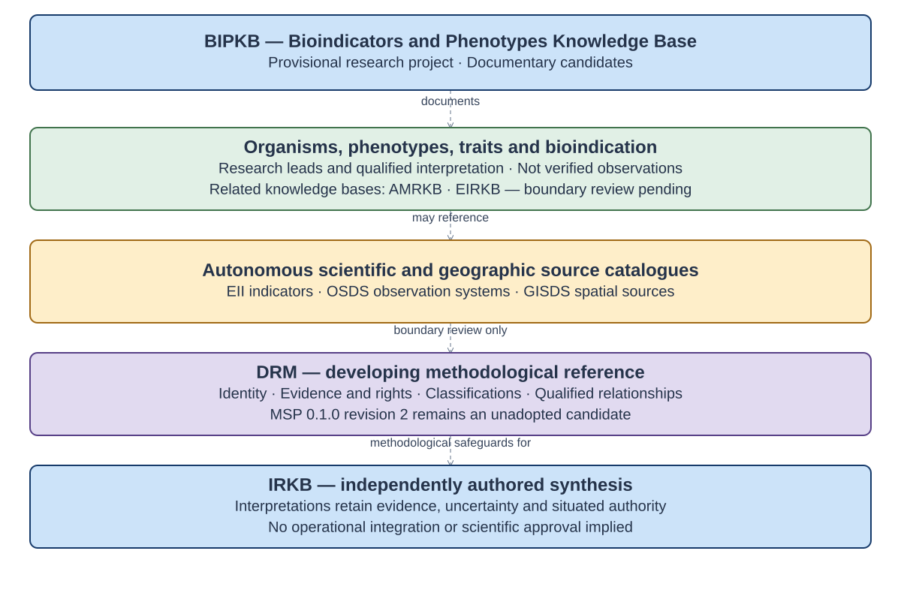
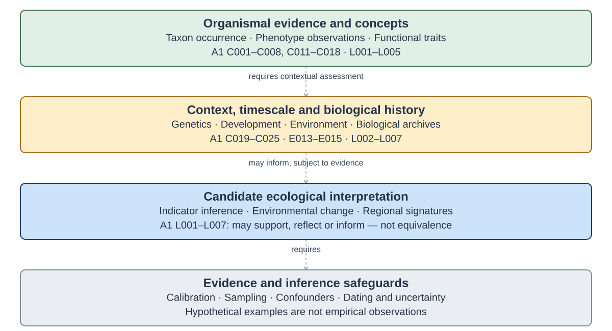

# BIPKB — Bioindicators and Phenotypes Knowledge Base

BIPKB is a provisional research knowledge base for bioindicators, observable phenotypes, functional traits, plasticity, organismal responses and qualified ecological interpretation.

[View full-size federation diagram](assets/diagrams/bipkb_federation.svg). Connections express provisional research responsibilities, not exclusive subject ownership, approved semantic mappings or operational adapters.

**Corpus revision:** 0.2.0 · Work in progress · Local documentary intake for review, not a research release.

## Research and reading

Read the [Scientific Reference Register](BIPKB_Scientific_Reference_Register.md) for the detailed concepts, resources, indicator families, historical people, bibliographic leads and qualifications. The [Machine Reference](BIPKB_Machine_Reference.json) is the sole structured authority; the [Research Protocol](BIPKB_Research_Protocol.md) explains methods, evidence, identity and independent statuses. [Citation metadata](CITATION.cff) and the [changelog](CHANGELOG.md) retain attribution and actual development history.

The source landscape includes taxonomic and occurrence resources, trait and phenotype infrastructures, biological monitoring, standards and ontologies, institutions, discovery services and software. These roles differ: a portal is not a dataset, a trait definition is not a measurement, and an observed response is not a uniquely established environmental cause.

## Documentary inventory

All **293 A1 origin IDs and complete row fields** are preserved with section qualifications and A2 reconciliation. Counts below describe typed documentary entries, not unique verified scientific entities. Original claims and twelve correction proposals coexist. Open Traits Network and TDWG have repeated mentions pending identity review; they have not been merged.

| Collection | Entries |
|---|---:|
| records | 146 |
| references | 10 |
| classifications | 39 |
| memberships | 0 |
| relationships | 15 |
| examples | 15 |
| methodological notes | 36 |
| research queue | 32 |
| assertions | 12 |

The 146 research leads comprise 25 concepts, 35 resources/programmes, eight indicator families, ten heterogeneous standard/ontology/service leads, 24 historical people, twelve institutions, eight communities and 24 discovery/reference/software leads. The 39 classification definitions are 25 proposed territories and fourteen proposed dimensions; none is adopted. The fifteen examples are hypothetical, not empirical observations. Relationships have unresolved label endpoints; no scientific identities or mappings have been accepted.

Scientific verification remains **unverified**, proposal review **pending**, canonical source lifecycle **not established**, access **not assessed** and reuse rights **unknown**, independently of documentary inclusion. No source-wide link, licence or DOI verification was performed. Sampled corrections in the archived reviews remain review-supported or conversation-reported.

## Conceptual research map

[View full-size conceptual reconstruction](assets/diagrams/bipkb_conceptual_reconstruction.svg). **Evidence-based reconstruction, not the original conversation diagram:** traced to A1 C001–C025, E001–E015 and L001–L007. The original map could not be recovered. Contextual dependencies and proposed inferences do not establish causality.

## Federation and research gates

EII concerns indicators and metrics, OSDS observation systems, GISDS geographic sources, AMRKB agricultural methods and EIRKB historical/theoretical research. BIPKB addresses biological evidence and interpretation, while IRKB owns independent synthesis. Boundaries permit overlap and require evidence and domain review. Situated and Indigenous knowledge requires its own attribution, consent and authority.

DRM-MSP 0.1.0 review revision 2 remains an **unadopted candidate**. DRM's two bounded Phase 4 pilots are closed; Phase 5 is unauthorised. BIPKB claims no DRM conformance or operational interoperability.

Stage 0 has a preserved documentary inventory and local candidate intake, awaiting source verification and owner review. Stage A foundations, Stage B observation/methods and Stage C interpretation have not begun as dedicated systematic research; their separate review gates remain. These research stages are distinct from repository workflow labels and DRM development phases.

## Evidence limits and reproducibility

Pinned evidence is the 2 November 2026 A1 audit, its review and A2 reconciliation. A1 is an assistant-authored documentary audit, not an immutable original transcript. Only five later Overview turns were accessible, one response truncated. One retrieved reconciliation fragment is preserved separately with message locators and its own fragment hash; it includes WOODIV edition metrics and resource-specific caveats not fully present in A2, without issuing new scientific-entity records. Original conversation completeness, original map recovery, primary bibliography, rights, identity resolution and fungal/microbial/global coverage remain unresolved. Full evidence pins, locators, dispositions and non-indexed context are in the Machine Reference.

Corpus/document revision 0.2.0 is distinct from local schema 0.2.0, protocol edition 0.2.0, A1/A2 source editions and external dataset releases. Matching numbers do not imply shared version authority.

From this repository, regenerate the Scientific Register and both SVGs with `python3 -B scripts/render_bipkb.py`. The Mermaid files in [assets/diagrams](assets/diagrams/bipkb_federation.mmd) are editable authorities with explicit layout hints; the renderer uses only the standard library. Run `python3 -B scripts/render_bipkb.py --check`, `python3 -B scripts/validate_bipkb.py` and `python3 -B -m unittest discover -s tests -v`. Optional installed JSON Schema checking adds format coverage. Structural success is not scientific validation, authenticated authority or permission to reuse external material.

Research by Jonathan Minchin, Ecological Interaction ([ORCID](https://orcid.org/0000-0001-8152-1796)). No repository licence, DOI, research release or publication approval has been assigned. External sources retain their own rights.
